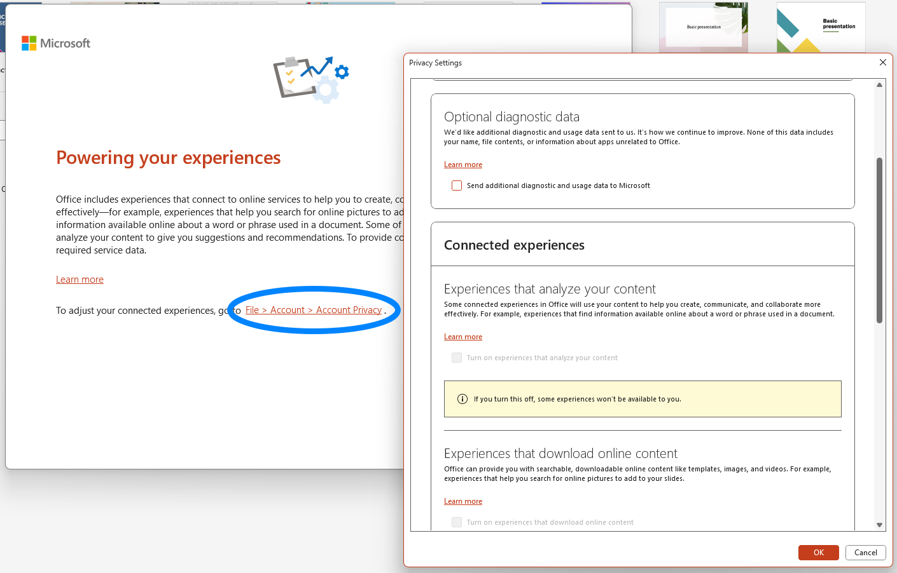
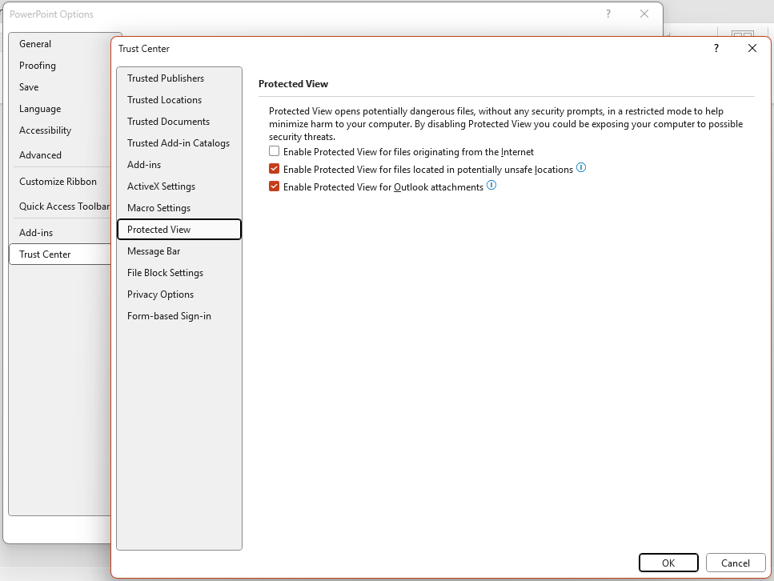

Sign in as **User** and start PowerPoint to change these settings.

- Office is installed automatically with Windows. Open PowerPoint.

- Open `File > Account > Account Privacy` and clear every privacy option.

- Open `D:\studio-mediafiles\_assets\default_presentation.pptx` and configure:
  - `Slide Show > Use Presenter View` must be **selected**.
  - `Slide Show > Monitor` must be set to `Monitor 3 AAA`.
  - Under `File > Options > Trust Center > Trust Center Settings… > Protected View`, clear:
    - `Enable Protected View for files originating from the Internet`

